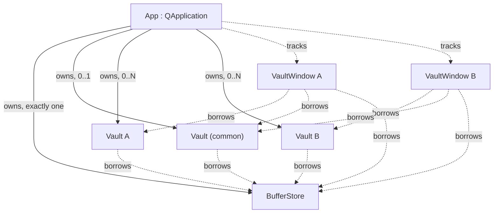
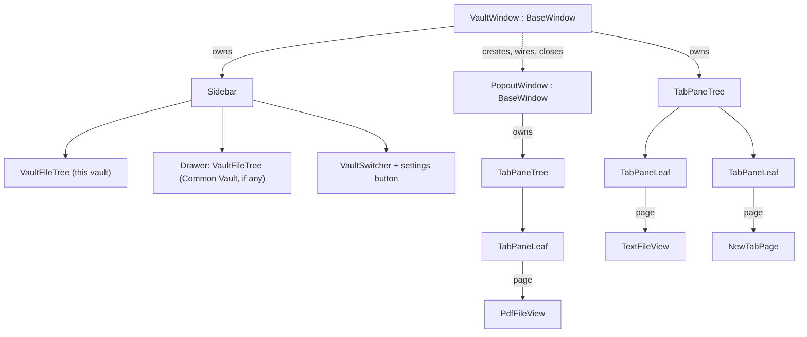
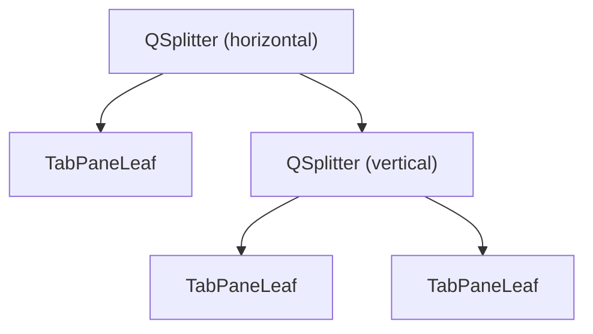
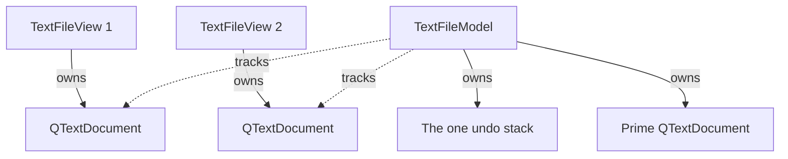
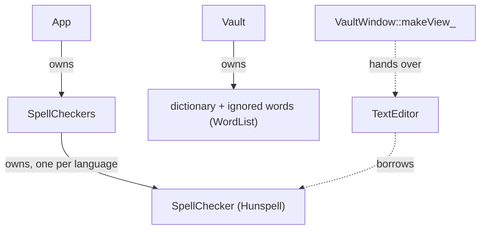
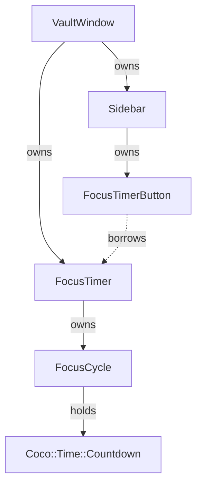
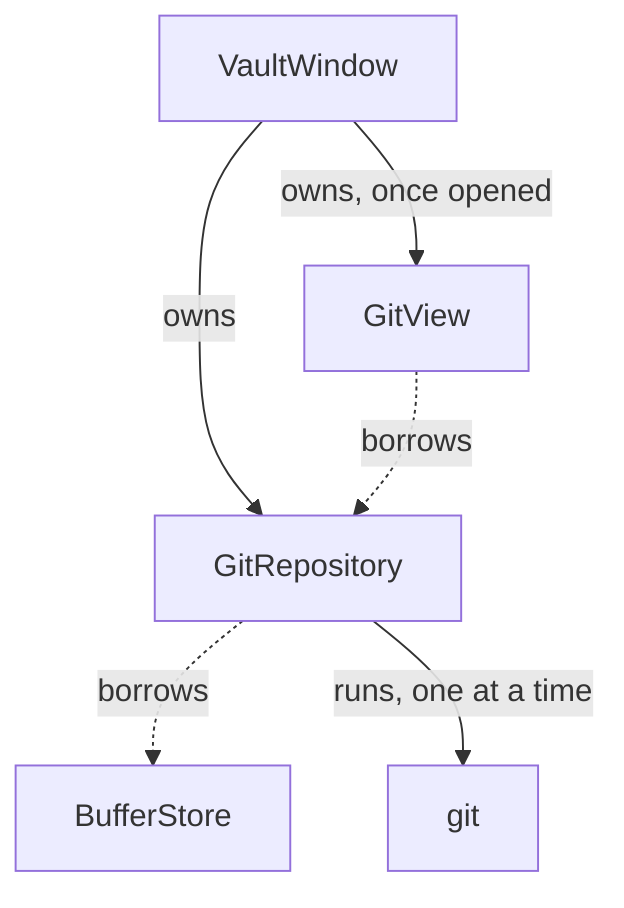

# Architecture

How Fernanda is put together, and why. For what it does, see [Features.md](Features.md); for what it doesn't do yet, [Future.md](Future.md); for code conventions, [CodeStyle.md](CodeStyle.md).

This document covers what spans several files: who owns what, what is guaranteed, and the reasoning that no single header can hold. Each class's own header comment covers the rest.

> [!NOTE]
> Fernanda is developed with AI assistance. I decide what Fernanda does and how it's designed, and I review and test every change before it goes in. [TODO.md](TODO.md) tracks known bugs and what the tests don't yet cover.
>
> Every push builds Fernanda and runs its [test suite](../tests) on Linux and macOS, with the Linux build using AddressSanitizer and UndefinedBehaviorSanitizer. I run the tests on Windows before pushing.
>
> If you find a problem, in the app, the code, or their documentation, please [open an issue](https://github.com/fairybow/Fernanda/issues).

## Principles

Two rules decide most questions, in this order:

1. **Sane.** Conventional C++ and Qt. Code should be predictable to anyone who knows the language and the framework.
2. **Simple.** Nothing more complex than the problem requires. No abstraction, indirection, or generality without a concrete consumer.

When the two conflict, sane wins.

Four structural commitments follow from them:

- **No off-disk buffers.** Every open document is a file that exists on disk. This is what makes unconditional autosave possible, and it removes save prompts, modified markers, and untitled-document naming.
- **No singletons and no service locator.** "Only one exists" and "reachable from anywhere" are different properties. Each object is owned by whatever owns the data it describes, and is handed to whoever needs it.
- **No signal relays.** A signal is emitted by the object that owns the fact. It is not echoed up a chain of parents. Where an action belongs to a distant owner, the owner creates the action and hands the pointer down.
- **One process.** `App` is a `QApplication`, and every open vault lives inside it. A second launch hands its arguments to the running instance and exits.

Obsidian is the behavioral reference. Where Fernanda's intended behavior is unclear, Obsidian's is looked up and either matched or diverged from on purpose. The divergences are listed in [Features.md](Features.md).

## Source layout

Everything is under `Fernanda/src/`, in the `Fernanda` namespace. Apart from `Main.cpp`, the code is header-only. The tests sit beside it in `Fernanda/tests/`; see "Tests" in [CodeStyle.md](CodeStyle.md).

| Folder | Holds |
|---|---|
| `src/` | `Main.cpp`, `App`, and the log window |
| `core/` | `Vault`, the buffer store, file keys, the vault tree model, configuration, file IO, file types, action ids, the focus timer and its rules |
| `core/spell/` | Spellcheck: the dictionaries, the word rules, and the vault's word lists |
| `core/git/` | The repository a vault is in, and reading what `git` prints: status, diffs, remote addresses |
| `models/` | One buffer class per file type, and the prime document |
| `views/` | One view class per file type, and the parts only views use: the text editor with its selection handles and typing helpers, the find bar and the search functions behind it, and the zoom control with its state |
| `ui/` | The windows and what they open directly: workspace persistence, Go to File, the vault picker, the status bar items. Also the application's style |
| `ui/tabs/` | The split tree, its leaves, the tab bar and its buttons, the new-tab page |
| `ui/sidebar/` | The sidebar, the file trees, the common drawer, the vault switcher |
| `ui/settings/` | The settings dialog, its pages, and their rows |
| `ui/git/` | The Git view, its status bar button, the top bar with its branch list and New Branch dialog, the changes list's delegate, and the diff |
| `ui/widgets/` | Controls that know nothing of the app: glyph rendering, the flat-button wash, the toggle switch, the slider, name checking, the row labels shared by the file tree and Go to File |

Folders are for finding files; they don't set namespaces. Everything under `ui/` is in `Fernanda::Ui`, whatever its subfolder; everything else is in `Fernanda`.

Includes run one way, from the top of this list down:

- `App` includes anything.
- `ui/` includes `views/`, `models/`, and `core/`.
- `views/` includes `models/` and `core/`. From `ui/` it takes only `ui/widgets/`.
- `ui/widgets/` takes nothing from the app but `ui/UiConstants.h`, which itself includes nothing of Fernanda's.
- `core/` and `models/` include each other, and nothing from `views/` or `ui/`.

`Vault`, `BufferStore`, and everything they own create no window or widget and refer to none, so the data layer can't come to depend on one. They are not limited to QtCore: a text buffer is a `QTextDocument` with a plain-text layout (QtGui and QtWidgets), an image buffer holds a `QPixmap`, and a PDF buffer a `QPdfDocument`. `VaultTreeModel` and the configuration types are QtCore only.

[Coco](https://github.com/fairybow/Coco), a submodule, supplies paths (`Coco::Path`), logging, debounce timers, the countdown the focus timer runs on, and the single-instance guard. [Hunspell](https://github.com/hunspell/hunspell), also a submodule and pinned to a release tag, checks spelling. It has no CMake build of its own, so Fernanda's CMake builds its sources as a static library, with its warnings off.

## Ownership

| Owner | Owns |
|---|---|
| `App` | The `BufferStore`, the Common Vault's `Vault` when there is one, every project `Vault`, `AppConfig`, the app-wide actions, the spelling dictionaries (`SpellCheckers`), the update checker (`Updater`), the interface language (`Translations`). Tracks each `VaultWindow` and the `ManageVaults` window |
| `BufferStore` | Every open file's buffer, the watcher over open files, the autosave timers. Keeps a list of every vault's `VaultTreeModel`, which it doesn't own, and announces each rename, move, and trash it follows |
| `Vault` | Its `VaultTreeModel`, its `VaultConfig`, its dictionary and ignored words, its `.fernanda/` folder. Borrows the store |
| `BaseWindow` | The window's `TabPaneTree`, its action registry, its status bar |
| `VaultWindow` | Its `Sidebar`, its `WorkspaceFile`, its settings dialog, its `FocusTimer`, its `GitRepository` and `GitView`, and the creation of its pop-outs. Borrows its vault, the Common Vault (if there is one), and the store |
| `PopoutWindow` | Nothing of its own. Its `VaultWindow` wires it |

**`App` owns every `Vault`.** If windows owned their vaults, `Vault` would have two kinds of owner: `App` for the common one, a window for the rest. Owning them all in one place makes the Common Vault an ordinary `Vault` with a role, which `App` can give to any vault, or to none (see "The Common Vault").

**One store for every buffer.** A file has one buffer however many windows show it and however many vaults contain it: vaults may nest, and a project vault may contain the Common Vault. If each vault kept its own buffers, a file inside two vaults would have two, each autosaving over the other and each reloading the other's saves as outside changes, and a rename in one vault would discard the other's buffer with its unsaved text. So `App` makes one `BufferStore` before any `Vault` and lends it to every `Vault` and every window. A `Vault` keeps what is its folder's alone: the tree, the settings, and the dictionary.

**One `Vault` per folder.** `App` enforces it, comparing folders after resolving them through symlinks (see "Identity"). The Common Vault can be opened as a window of its own, and that window is given the `Vault` that `App` already holds. A vault set as the Common Vault while it's open in a window becomes the Common Vault as it is. A second `Vault` over one folder would split its settings and dictionary between two objects. Because of this, "is this window the Common Vault's own?" is a pointer comparison everywhere it is asked.

**Windows are tracked, not owned.** They are parentless top-level widgets that delete themselves on close. `App` holds pointers to them and reacts to their `destroyed` signal.

## Lifetimes

These rules are easy to break and expensive to rediscover.

- **`destroyed` arrives from a half-dead object.** It is emitted from `~QObject`, after the derived parts are gone, so the sender can't be cast back to its type. A handler that needs to know which window died captures something that outlives it. `App` captures the window's `Vault`, not its path: the vault's folder may have moved while the window was open.
- **A child's signals can reach a parent whose destructor has finished.** A widget deletes its children in `~QWidget`, after its own class's destructor has run, and Qt cuts a receiver's connections only in its `~QObject`, later still. So a parent's handler for a child's `destroyed` can run on an object that is no longer its own type, and reading any of its members then is undefined behavior. A parent that handles its children's `destroyed` cuts those connections in its own destructor, as `TabPaneLeaf` does with its pages.
- **A `Vault` is disposed with `deleteLater`, never `delete`.** `destroyed` is emitted before the object's children are deleted, so the window's views and sidebar may still be alive and connected to the vault. Deferring puts the vault's deletion after the window is fully gone.
- **The Common Vault's `Vault` is never disposed by a window closing** while it's the Common Vault. It belongs to `App`, and other windows still show its tree. When another vault is set, or none, the old one is disposed at once if no window holds it, and otherwise with its window.
- **Buffers watch `destroyed`; views don't call back.** A buffer counts its views by connecting to each one's `destroyed`. No view destructor calls into its buffer, so teardown order doesn't matter.
- **A view always outlives its reach into the store.** The store is `App`'s and never dies with a window, and at quit Qt destroys top-level windows before `App`'s children. So the last view closing always finds a live `BufferStore`.
- **`App` decides when to quit.** Quit-on-last-window is off. The app quits when no vault window is open and the vault picker isn't up.
- **Quit goes through each window's close.** The Quit action closes each vault window in turn and stops at the first refusal. It never calls `quit()` directly, which would skip the final save and the chance to refuse.
- **Pop-outs are siblings of their vault window,** not Qt children: a child window can never be stacked behind its parent. The vault window keeps a list of its pop-outs and closes them itself.
- **Raw pointers are the default.** A pointer that can outlive its target is cleared from that target's `destroyed`. On the single GUI thread this is equivalent to `QPointer`.
- **Nothing is logged during `App`'s construction.** Logging starts in `App::init`.

## Windows and views

- **`BaseWindow`** is what both window types share: a `TabPaneTree`, the action registry, the status bar, and the actions any window can perform itself (undo, redo, zoom).
- **`VaultWindow`** adds the sidebar, file opening, workspace persistence, and the settings dialog. It is the only place pop-outs are created, and it wires every pop-out's tree the same way it wires its own.
- **`PopoutWindow`** adds nothing. It has no close logic, because it has no state: buffers live in the `BufferStore`.

### The composition rule

`VaultWindow` composes components and never reaches inside them. Each component handles its own interaction and emits a signal that states intent: the file tree emits "open this path" or "rename this to that", and the sidebar routes it to the vault that owns the path. If the window ever reads a component's internals, the rule is broken.

This is what keeps a main window from accumulating one method per interaction in the app.

### Pages

A tab's content is a page, and a page is a plain `QWidget`. `TabPaneLeaf` and `TabPaneTree` never learn what kind of page they hold.

- A file view is an `AbstractFileView`, one view of one file. Each file type has its own subclass.
- A new tab holds a `NewTabPage`. It is not a file view: a tab with no file has no buffer, and a placeholder buffer would be exactly the off-disk buffer the design rules out. Choosing a file replaces the page in place.
- What a tab needs from its page travels on the page widget: the title is its window title, and pin state and the tab's mark (which glyph, as an SVG path) are properties read through small helper headers. They follow the page through reorders, drags between panes and windows, and restore, with nothing else carrying them.
- Anything that asks "which file is in this tab?" casts the page to `AbstractFileView` and handles null.

`TextFileView` can't itself be a `QPlainTextEdit`, since views share the `AbstractFileView` base. It holds one: `TextEditor`, a `QPlainTextEdit` subclass that draws the line-number gutter, margins, highlight, and selection handles, and runs the typing helpers.

- **The editor's parts get its events first.** `SelectionHandles` and `TypingHelpers` are plain classes the editor owns, not widgets or event filters. The editor offers them each mouse event or key press before handling it, and one they take goes no further.
- **A typing helper's change is one edit block** in the view's document. The document reports a block as one change, so it reaches the buffer as one edit, and the buffer undoes it in one step. Replace All works the same way.

- **The handles need room inside the viewport.** They are painted into it, so they scroll with the text, and nothing there can be drawn past its edges. The space between the text and the editor's sides is therefore split: the document's margin (`TEXT_DOCUMENT_MARGIN`, wide enough for a handle's bulb, set when the document is built) is inside the viewport, and the rest of `TEXT_SIDE_PADDING`, with the left/right margin setting, is viewport margin outside it. Qt applies a document margin on all four sides, so it is also the space above the first line. A handle under the last visible row can still be cut off by the viewport's bottom until the text scrolls.

## The split tree

`TabPaneTree` is the pane area of a window: nested `QSplitter`s as branches, `TabPaneLeaf`s as leaves, each leaf holding a tab bar and its pages.

- **The tree is a widget that owns its root splitter; it is not the root itself.** Splitting the root against its orientation means wrapping it in a new splitter. Owning the root lets it be swapped while the window's central widget, and every pointer to it, stays put.
- **Split.** A split in the splitter's own orientation adds a pane beside the target, halving only the target's space. A split across it wraps the target in a new splitter.
- **Collapse.** A leaf with no tabs is removed, unless it is the last one. A splitter left with one child is unwrapped. Skipping this leaves invisible one-child splitters that corrupt saved layouts.
- **The active leaf follows keyboard focus.** The tree watches application focus changes and ignores any outside itself, so leaves need no "I'm active" signal and each window's tree is independent.
- **A window focuses its active page on first show.** A hidden widget can't take focus, so focusing pages during restore does nothing. `BaseWindow` does it once the window is shown.
- **A tab press focuses its page after the bar handles it.** `QTabBar::tabBarClicked` fires before the bar changes the current tab, and the change moves focus again, so `TabBar` emits its own `tabPressed` afterward.
- **The tree reports its active page.** The status bar follows that signal, not focus, because closing a tab or restoring a layout doesn't reliably move focus.
- **Restore builds a detached tree and swaps it in at the end.** Collapse handling is suspended during a restore; otherwise the half-built tree reports itself empty, which closes a restoring pop-out before it is shown.

### Dragging tabs

A tab drag uses Qt's drag and drop for one thing: delivering drop events across top-level windows. Nothing is serialized.

- The drag's payload is a marker. The target reads the dragged page from the source tree, which Qt provides for a drag within one process.
- The page moves only when a drop is accepted. Until then the source tab stays where it is, so the source pane is never empty mid-drag.
- A drag is valid only within one vault's window family: the vault window and its pop-outs. Each tree carries its family's identity, and a drop on another family's window is refused.
- A drop that no pane accepts pops the tab out into a new window.
- Drop zones are a pane's tab bar (add the tab), its four edges (split), and its center (currently the same as no zone).

A file dragged from a file tree uses a separate private format carrying absolute paths. The tree views accept it to move an entry; the split tree accepts it, files only, to open one. Because the format is private, nothing can be dragged out of the app.

## Documents

### One buffer per file

The `BufferStore` keeps one buffer for each open file, keyed by the file's `PathKey`. Every view of that file, in any tab, pane, or window, shares it, so a file open in two windows is one buffer, and live sync between windows needs no mechanism of its own. The same holds for a file inside two vaults: it has one key, so it has one buffer.

A buffer is freed when its last view closes, in any window, after a final save. If that save fails, the buffer is kept.

Closing a tab does no file IO. It destroys a view, not a buffer.

### File identity

A file is identified by its `PathKey`: its absolute path, normalized (see "Identity"). A model holds its key; nothing in a model or a view points at a `Vault`.

Which vault a file belongs to is a question each window asks, not something the file carries: in a window, a file inside the window's own vault is that vault's, even when the Common Vault contains it too, and otherwise it is the Common Vault's when that contains it (`VaultWindow::vaultOf_`). Opening, the guest mark on a tab, and `workspace.json` all go by that answer. So one buffer can be a project file in one window and a Common Vault file in another.

The answer can change under an open tab. Vaults nest, so one vault's window can rename or move a file another window shows, out of that window's vaults or from one of them to the other; and the Common Vault can change. Each view's window asks again a tick after its buffer reports a rename, by which time `App` has followed any moved vaults, and for every tab when the Common Vault changes:

- **In neither of its vaults:** the view closes. The buffer stays open in any window that still shows it. If none does, the last view's final save writes any unsaved text to the file's new place, so a move never loses typing.
- **In the other of its two vaults:** the guest mark is set or cleared. A tab draws its mark only when it gains a page, so the window asks the tab to draw it again (`TabPaneTree::refreshPageIcon`).
- **Either way,** the window schedules a workspace save, since `workspace.json` holds the old path.

The file trees hand out absolute paths; the sidebar makes them keys.

### Buffers

`AbstractFileModel` is the base: its key, its bytes in and out, modified state, undo, and the view count. A buffer does no file IO. The store reads bytes and gives them to the buffer, and takes bytes from it to write.

| Class | Holds |
|---|---|
| `TextFileModel` | The prime document, the file's line ending style and byte order mark |
| `PdfFileModel` | The file's bytes and one parsed PDF document, shared by every view |
| `ImageFileModel` | The file's bytes and one decoded image, shared by every view |

Which class a file gets is decided by its extension, from one table in `core/FileTypes.h`. The same table decides what the file trees and Go to File list, so they can't disagree with what the vault will open. `BufferStore::openModel` refuses anything not in the table before reading it; that refusal is the authority, and the hiding upstream is a courtesy.

PDF and image buffers share no base beyond `AbstractFileModel`. What they have in common is one byte array.

### The prime document

Qt gives a text document one layout, and an editor installs its own. Two editors on one document would share one layout, and so one wrap width. Qt has no supported way around this.

So each text view owns a document of its own, and the buffer owns one more, the prime, which no view displays. An edit in any view's document is applied to the prime and to every other view's document.

- The prime belongs to no view, so closing any view, in any order, leaves the content intact.
- Applying an edit to another view's document makes that document report an edit too. A guard around the fan-out stops the echo.
- **A view's document is formatted before it is shared.** Qt reports a change to a document's format (its margin, for one) as a change to all of its text, removed and added again unchanged. Made to a registered view document, that would be routed as an edit: an undo step, a modified file, and an autosave. So everything about a view document's format is set when it is built (`TextEditor::buildDocument`), before `PrimeDocument::registerView`. Settings that change later, like the font and the tab width, are the editor's and don't touch the document's format.
- **A change that leaves the text as it was is not an edit.** As a backstop, the buffer drops a view's change that removes and adds the same text, so a format change made after registration still goes nowhere.
- Undo lives on the prime alone. View documents have undo disabled; otherwise each view would undo only its own edits and the views would drift apart. The editor gives up the undo and redo keys so the window's actions handle them, and those actions reach the active view's buffer.
- A reload is its own undo step. Qt folds an insertion into the one before it when the two touch and the document is marked modified, so text typed at the end of reloaded text would otherwise undo together with the reload. `TextFileModel` clears the modified flag straight after a reload, because the buffer matches disk again, and that is also what keeps the two apart.
- After every routed change the prime checks each view's document against its own and resets one that differs, since the prime is what gets saved. Every build compares lengths; a debug build compares the text too. Nothing known causes a difference.
- Find and replace work in one view's document. A replacement is an edit there like any other, so it reaches the prime and the other views the same way. Replace all is one edit block, which a document reports as one change, so it is one undo step.
- Text is read from a document through a lossless path. Qt's plain-text accessor rewrites no-break spaces and some separators, which would silently change a file on its first save. Copying follows the same rule: the editor builds the clipboard's text itself, as plain text only, since Qt's own copy makes the same rewrites and adds rich formats.

## Saving

Nothing here is user-facing. There is no modified marker and no save command. A buffer's modified flag exists only so a save pass can skip buffers that already match disk.

### One write site

Every save, whatever triggered it, goes through one private function in `BufferStore`. That is where the write is fingerprinted for the watcher, where a failure is logged, and where a missing file is detected. A failed write leaves the buffer modified, so the next trigger retries it.

| Trigger | Where |
|---|---|
| Typing | `BufferStore`: one debounce and one ceiling timer for every buffer |
| App loses focus | `App` |
| A window closes | `VaultWindow`, before it accepts the close: the files its views show, in it and its pop-outs |
| Quit | `App`: every buffer, including one no window shows |
| OS logout | `App`. Logout never delivers a close event |
| A buffer's last view closes | `BufferStore` |

The debounce restarts on every edit and fires when typing pauses. The ceiling starts once per burst and is never restarted, so it still fires under input that never pauses. Whichever fires first saves every modified buffer. One pair for the whole app is enough: one writer types one burst at a time.

A window close saves only the files the window shows, so a file that fails to save in another window can't hold this one open. A buffer no window shows, kept after its last view's save failed, is retried on focus loss and at quit. Each of these exit paths also writes its vault's pending settings change (`Vault::saveSettingsNow`).

### A save never creates

A buffer's file is always on disk. If it is missing at save time, it was deleted or moved outside Fernanda and the watcher hasn't said so yet. The save writes nothing, creates no folders, and hands the path to the watcher's reconcile, which closes the buffer. This is not reported as a save failure.

The same rule holds one level up: a workspace save never creates a missing vault folder.

File IO takes an explicit create-folders argument at every call. Only configuration writes, whose folders may not exist yet, pass yes.

### Save failure

Automatic saves log a failure and retry. A window close is the one moment a failure is both visible and still refusable: the window lists the files and stays open.

### Byte-faithful text

A text file is written back as it was read, apart from the user's edits. The prime document holds only `\n` and no byte order mark; `TextFileModel` records both on load and restores them on the way out. The one exception is a file that wasn't valid UTF-8 and that the user chose to open anyway: it is rewritten as UTF-8 at once, so the question never needs asking again.

## Watching the filesystem

Two kinds of watcher track different things with different lifetimes.

- **The buffer watcher**, one in the `BufferStore`, watches each open file, for as long as it is open.
- **Each tree model's watcher** watches each folder a view of that vault's tree has listed.

### Open files

Change events are collected and handled together a moment later, so a Git checkout that rewrites many files is one pass.

For each changed path:

- **Gone:** the buffer is discarded and its views close themselves, in every window.
- **Bytes equal to what Fernanda last wrote:** ignored. The store records a hash of each write, and compares disk against that hash, not against the live buffer, which typing may have moved on.
- **Bytes equal to the buffer:** ignored.
- **Anything else:** reloaded into the buffer as one undoable edit.

Two details matter on every platform. Many programs save by writing a temporary file and renaming it, which drops the path from the watcher, so a path is re-added after any change. And Fernanda's own saves work the same way, so the watch is removed around each write and restored after.

### Vault folders

When Fernanda becomes the active application again, `App` checks that every open vault's folder still exists. A missing vault has its window closed, and a missing Common Vault is unset, since where its folder went can't be known. The watchers aren't relied on for this: whether a folder's own removal is reported varies by platform.

A folder can also move from inside Fernanda. Vaults nest, so a rename, move, or trash in one vault can take another open vault's folder, or the Common Vault's, with it; and Manage Vaults renames a vault's own folder. Fernanda knows both ends of such a move, so a vault follows its folder and stays open:

- **The store announces it.** `BufferStore` emits `entryRelocated` or `entryRemoved` once every tree and buffer has followed the entry. Manage Vaults' rename goes through the store too (`App::renameVaultFolder_`), as a `Vault`'s own rename does: the store releases every watch inside the folder, `Io::rename` renames it, and the store applies the move.
- **A rename or move is followed at once,** in `App`'s slot for the announcement (`App::followVaults_`). Every known vault's record at or under the entry takes its folder's new path. Every live `Vault` there, the Common Vault and each one with a window, moves to the new place (`Vault::moveRoot`): its root, its tree, which watches its listed folders again there, and where its settings and dictionary are written. `App`'s open-vaults map is keyed again, and for the Common Vault, `commonVaultPath` follows. A change of letter case alone, where case is ignored, is followed the same way.
- **Every copy of a root follows `rootMoved`:** the vault switcher's, the Common Vault drawer's title, `WorkspaceFile`'s, and the settings dialog's title and label. A tree view keeps no copy; it asks its model.
- **It's done before anything else reacts.** Each window looks at its relocated tabs a tick later (`VaultWindow::makeView_`), and by then their files must be in the moved vaults, or their tabs would close. And no event loop runs in between, so no window can be activated with its record and its root out of step: activation records a vault's use by its root's path, adding a record it doesn't find.
- **Paths held elsewhere are followed by their holders.** A `PathKey` is a value and doesn't change under its holder. Besides `App`'s map, a window's recent files are rebased when the store announces a move (`RecentFiles::rebase`). What the window holds by pointer, its `Vault`, needs nothing.
- **A trash waits a tick,** so the vault operation and the window that started it have finished before any window closes. Then one message says the folders went to the trash, and the windows close as in the outside case. A trashed Common Vault is unset.

## The vault tree model

`VaultTreeModel` is one model per vault, owned by the `Vault`. Every tree view of that vault sits on it: the vault's own tree, and for the Common Vault the drawer in every window. Expansion and selection belong to each view.

**Why the vault owns it.** On Windows, a watched folder is an open handle, and a handle on a folder blocks renaming, moving, or deleting any folder above it. Qt's own file system model keeps a private watcher with no way to release a folder, so one model per tree view meant Fernanda's own folder operations failed whenever any tree had listed a subfolder. Owning the model gives the `Vault` control of the watcher that holds the handles.

- **Listing is lazy and synchronous.** A folder is read the first time a view asks for its children.
- **The watched set is the listed set.** There is no separate record.
- **Hidden and unsupported entries are never listed,** so they are never watched. Nothing under `.git/` holds a handle.
- **A node stores only its name.** A path is built by walking up to the root, so renaming or moving a folder changes one node.
- **Outside changes re-list the folder as a diff.** Unchanged entries keep their nodes, so views keep their expansion and selection. A re-list that finds nothing to do is harmless, so the model needs no suppression of its own writes.
- **Fernanda's own operations update the model directly.** Before a rename, move, or delete, the store releases the watches at or under the entry in every vault's tree, not only the acting vault's: vaults can nest, and another vault's window may have listed a folder inside the entry. Afterward it moves or removes the node in every tree. A moved folder's node is the same object, so it stays expanded in every view, in every vault's window. Left to its own watcher, another vault's tree would re-list the folder and see a new, collapsed entry.
- **Each tree is handed the entry in its own spelling.** A tree finds its rows by comparing names exactly, and where letter case is ignored, two vaults' roots may spell the folders above them differently. So the store rebuilds the entry from the tree's own root and the part of the entry below it. Below a root every tree lists the same folders from disk, so those names agree.
- **A tree whose vault folder is the entry, or inside it, has no row for it.** The whole vault went with the entry. After a rename or move, `App` moves its `Vault` to the new place; after a trash, it closes the vault's window (see "Vault folders"). After a change of letter case alone, where case is ignored, the folder is still there, and the store gives the tree its watches back before `App` moves it to the new spelling.
- **A tree's root can move** (`VaultTreeModel::moveRoot`). No node changes, so every view keeps its expansion and selection, and the listed folders are watched again under the new root. Every path the model hands out is built from the root, so a tree view asks the model for it each time rather than keep a copy.
- **Paths are typed.** Views read a `Coco::Path` and an is-folder flag from the model, not Qt item roles.

Outside programs are still blocked from renaming a folder that Fernanda has listed a subfolder of. See "Watching a whole vault through one handle" in [Future.md](Future.md).

## Identity

**A vault is its path.** Nothing identifying is stored in the vault folder. The known-vaults list, the open-vaults map in `App`, and saved workspaces all resolve by path. The open-vaults map is keyed by `PathKey`, so any spelling of an open folder finds its window, and the known-vaults list matches its records by `PathKey` (see "The known-vaults list"). This matches Obsidian, whose vault ids are opaque handles in a per-machine file.

The cost is that a vault moved outside Fernanda is a new vault. One moved inside Fernanda is followed, since Fernanda knows both ends of the move (see "Vault folders"). The benefit is that a copied vault folder is simply a second vault, with nothing to collide.

**A file is its `PathKey`.** `Coco::Path` compares paths as written, so a trailing slash, `.` and `..` segments, and letter case make two spellings of one file differ. `Coco::Path` is deliberately not canonical on construction: that would make it impossible to name a path that doesn't exist yet, and would put a filesystem call in a value type. `PathKey` (`core/PathKey.h`) is the normalized form every buffer and file operation goes by:

- **Made from the path alone.** `.` and `..` are removed, and the path is written in its pretty form (below). Nothing asks the disk, so a file that doesn't exist yet (a new file, a rename's target) has the key it will have once it does. A relative path gives an empty key.
- **Letter case is compared as the platform's file systems do.** On Windows and macOS, which ignore case by default, keys compare case-folded; elsewhere exactly. Qt reports a path in the case it was written, not the case on disk, so this can't be settled by asking. The path keeps the case it was written in, for display and for file operations.
- **Symlinks are not followed.** A file reached through a symlinked folder keeps a path inside the vault the link sits in, so a folder linked into a vault works as part of it, as in Obsidian. The cost is that a file reachable two ways through a link has two keys, and so two buffers. Obsidian asks for the same thing: link targets "fully disjoint from the vault root or any other symlink targets".
- **Vault roots are resolved through symlinks, once.** `App` resolves a vault's folder (`Coco::Path::canonical`) before it looks for an open `Vault`, so one folder reached two ways is one `Vault`, and every key made under a root starts from the same spelling.

**A path is normalized, not refused.** Every public `Vault` function takes keys. `Vault::contains` asks whether a key is the root or inside it, and creating, renaming, moving, and trashing all answer to it. Because a key is normalized, `<vault>/a/../..` is outside the vault and refused, and `<vault>/a/./b` is simply `<vault>/a/b`, the same file and the same buffer.

- A rename's new name must be a single name.
- A path read from `workspace.json` must be relative and plain before it is joined to a root, so a hand-edited entry can't name a file outside its vault.
- `BufferStore::openModel` refuses only an empty key. Which files a window may open is the window's to decide: one inside either of its vaults.

`workspace.json` stores each tab and recent file as a vault label and a path relative to that vault's root: "this" for a file inside the window's vault, "common" otherwise.

**A path written as text is in its pretty form** (`Coco::Path::prettyQString`), in `workspace.json`, in `fernanda.json`, in a `PathKey`, and on screen: the root as the platform reads it (a UNC root keeps its two slashes), then the names, joined by single forward slashes, with none at the end. It is built from the path's own parts, so the platform decides what a separator is; on Linux and macOS a backslash is part of a name. `.` and `..` are kept. Reading the text back names the same path; a Windows device path (`\\?\...`), where `/` isn't a separator, is kept as written for that reason.

## The Common Vault

The Common Vault is a role, not a place: one known vault whose files every window shows in a drawer beside its own, and whose dictionary applies in every vault. Any vault can have the role, or none.

- **`fernanda.json` records it in one key, `commonVaultPath`, with three states.** Absent: the first run hasn't set one up, so it makes `Documents/Fernanda/Common Vault` and sets it. `null`: the user unset it, or its folder went. A path: the Common Vault. Once one has been set up, the user's choice stands, including a choice of none.
- **It is always a known vault.** Setting a path that isn't listed adds a record for it, and `AppConfig` refuses to forget the Common Vault's record: it is unset first.
- **A Common Vault whose folder is gone is unset,** at launch or when Fernanda becomes active, and stays unset until the user sets another. Its record stays, listed as missing.
- **It changes in one place.** `App::setCommonVault_` takes a path, or none. It keeps one `Vault` per folder: a vault open in a window becomes the Common Vault as it is. The old one stays with its window as an ordinary vault, or is disposed if it has none. Then each window is told (`VaultWindow::setCommonVault`):
  - the sidebar's drawer is replaced or removed, and `WorkspaceFile` observes the new one;
  - every view moves its connection from the old Common Vault's `wordsChanged` to the new one's, and takes its words again. Each view is disconnected from the old Common Vault by name, since the old one may be the window's own vault, whose connections stay;
  - every tab is looked at again, as for a moved file: one in neither of the window's vaults closes, and the rest are marked as guests or not.
- **It follows its folder when Fernanda moves it,** as every vault does (see "Vault folders"): a rename in Manage Vaults, or a rename or move from a containing vault's tree. Its `Vault` moves first, so its files are still a Common Vault's when the windows look at their tabs, and its own window, if open, stays open. A trash unsets it.
- **The drawer's title is the Common Vault's folder name.** The header paints only the box glyph (`COMMON_DRAWER_LABEL`), so the name is its tooltip and accessible name, and is painted if the label is switched on. It follows a move and a change of Common Vault.

## Configuration and persistence

All of it but a vault's dictionary is JSON, read and written by stateless free functions (`core/JsonIo.h` over `core/Io.h`, which writes atomically). A missing or unreadable file reads as an empty object, so callers fall to their defaults.

| What | File | Type | Owner |
|---|---|---|---|
| Known vaults, the Common Vault, session, last-used folder, update settings, interface language | `fernanda.json` in the app data folder | `AppConfig` | `App` |
| Per-vault settings | `.fernanda/settings.json`, `.fernanda/appearance.json` | `VaultConfig` | `Vault` |
| Window and tab layout | `.fernanda/workspace.json` | `WorkspaceFile` | `VaultWindow` |
| A vault's dictionary | `.fernanda/dictionary.txt`, one word per line | `WordList` | `Vault` |

- **Each config type holds its own defaults.** A missing key falls to the default. There is no chain of fallbacks between vault and app settings.
- **Only set keys are written.** The Common Vault's is the exception: once set up, it is always written, as `null` when unset, since an absent key means the first run hasn't set one up.
- **Config types are plain values, not `QObject`s.** `Vault` announces a settings change with one signal, and saves a moment later so a dragged slider writes once, or at once when a window closes or Fernanda quits.
- **A vault setting changes one way.** `Vault::setConfig` takes the `VaultConfig` setter to call and the value. It announces and saves only if that setter reports a change, so no setting has code of its own in `Vault` to get wrong.
- **Settings are applied from the window's vault.** A Common Vault file in a project window takes the project's settings. A tab can only move within one window family, so a view's settings source never changes.
- **`ui/UiConstants.h` and `views/ViewConstants.h` are not configuration.** They hold values tuned in code and constants shared between classes.

### The known-vaults list

`fernanda.json` holds one array of vaults, each with its path, when it was last used, and whether it is open.

- The last-used time orders the list. Activating a vault's window updates it in memory; it reaches disk at exit.
- The open flag is the session: at launch, every vault flagged open whose folder exists is reopened, oldest first, so the most recent ends up in front. If none qualifies, the vault picker is shown.
- The flag is kept live: set on open, cleared on close. The last vault to close keeps it, and so does every vault open at quit.
- **Records are matched by `PathKey`, and one folder has one record.** A touch, an open, a rename, or a forget finds a folder's record by any spelling. A file with two records for one folder has them merged when it's loaded, and a record renamed onto a folder that already has one is merged with it: the more recent timestamp, and open if either was.
- A record keeps the spelling it was made with until it's renamed. A case-only rename that leaves a vault in place renames its record to the new spelling.
- A record follows its folder when the folder is renamed or moved inside Fernanda (see "Vault folders"). After an outside move it is shown as missing.

`App` derives a display entry per vault on demand (`VaultEntry`: name, missing, open, is-common) and hands the picker and each vault switcher a function that returns the current list, most recently used first. The picker can show it by name instead (`VaultOrder`, kept in `fernanda.json` as `vaultOrder` and written only when it isn't the recent order). The order is the picker's alone, so the picker sorts its own copy and the switchers keep the recent order. "Open" means a window holds the vault. It is not the same as "a `Vault` object exists", which for the Common Vault is true even with no window, and which is why is-common is a separate flag.

### Workspace

`WorkspaceFile` knows where things go in `workspace.json` and when to save. It doesn't know what a page is.

- **Each piece is an opaque blob made by its producer.** Window geometry, the sidebar splitter, the split tree, each file tree's expansion, and the drawer serialize and restore themselves. `WorkspaceFile` only places them.
- **The window translates pages.** `VaultWindow` gives `WorkspaceFile` functions to describe a page as JSON, build a page from JSON, and list and create pop-outs. The split tree calls the first two as it walks, so it never learns what a page is either.
- **A view writes its own state.** Each view type reads and writes its own keys (cursor, scroll, zoom) inside an object the window doesn't inspect.
- **State is captured at save time.** Cursor and scroll are read when a save runs, not tracked as they change. Saves are debounced off layout, geometry, and expansion changes, and forced on window close and at exit.
- **Restore runs before the window is shown,** and observation starts after it, so rebuilding the layout doesn't schedule a save of what was just read.
- **Scroll is applied after first show.** A scrollbar has no range until the view is laid out.
- **Recent files follow the active page.** `VaultWindow` records the file of each page that becomes active, in any of its trees, in a `RecentFiles` list. The list is written at save time and schedules no save of its own; it is restored after the tabs, so restoring them doesn't reorder it. Files gone from disk are dropped when it is written.
- **Every key is declared in `core/WorkspaceKeys.h`.**

## Spelling

- **One checker per language, shared by every vault.** A dictionary takes a moment and several megabytes to load, so `SpellCheckers` loads one the first time a language is asked for and keeps it. Dictionaries are read from the dictionaries folder in the app data folder, where any pair of `.aff` and `.dic` files is a language. A language must be a single file name, as a path read from `workspace.json` must be plain, so a hand-edited setting can't name a file outside the folder; anything else is treated as not installed. Hunspell reads from disk, so the bundled one is copied out of the resources at launch, and a file already there is never replaced.
- **A checker's answers never change,** because nothing is added to it after it loads. So it keeps every answer, and the editor can ask about each word in view at every paint.
- **A vault's own words are held apart from the checker.** A checker shared by every vault can't hold one vault's words. `Vault` holds its dictionary (from `.fernanda/dictionary.txt`) and its ignored words as `WordList`s, which apply Hunspell's rule for added words: lowercase also accepts capitals, capitals accept only themselves.
- **The window's vault decides, as for settings.** `VaultWindow::makeView_` hands each text view the checker for its vault's language (none while spellcheck is off) and one combined list: its vault's dictionary and ignored words, and the Common Vault's dictionary, if there is one. It hands them over again on `configChanged`, on `wordsChanged` from either vault, and when the Common Vault changes.
- **Views don't know their vault.** Add to dictionary and Ignore leave the view as signals, which `makeView_` connects to the window's vault.
- **Adding a word reads the file first.** The file, with the word added, becomes the dictionary, so a hand edit made while the vault is open isn't written over. A file that exists but can't be read is never written.
- **One rule judges a word.** `core/spell/Misspelling.h` takes the checker and the combined list, for the underlines and for the context menu. The checker is asked first, since it remembers its answers and most words are in the dictionary. Holding the vault's words apart has a cost that this rule pays: Hunspell accepts a possessive or a hyphenated word by its own rules, from its own words alone, so the rule tries an accepted word's possessive, and a hyphenated word's parts, itself. Add to dictionary and Ignore store a possessive without its 's for the same reason.
- **A dictionary Qt can't convert is known without loading it.** `SpellChecker` reads the encoding an affix file declares and tests it with the same converters a checker is built with, so Settings can mark such a dictionary and can't disagree with the checker about which ones work.
- **One rule finds the words.** `core/spell/SpellWords.h` decides what a word is, for the underlines and for the context menu. It is not the word counter's rule: a count wants "e.g." as one word, a spelling check wants its parts.
- **Underlines are painted by the editor,** over the text and for the visible blocks only, as search highlights are. Nothing is stored about the text, so an edit needs no bookkeeping: the next paint finds the words again.

## The focus timer

- **The rules are a plain value, given the time.** `FocusCycle` decides which period comes next, when a long break is due, and what pause, skip, and reset do. It holds no clock and no timer: every call that depends on the time takes it as an argument, so `FocusCycleTest` runs whole cycles on made-up times without waiting. It keeps each period as an end time (`Coco::Time::Countdown`), not as ticks counted, so nothing drifts however late it's asked.
- **A period ends only when told to.** `FocusCycle::tick` ends a period that has run out, once, however late the tick comes. Nothing starts on its own.
- **`FocusTimer` gives the cycle the time.** It passes `Coco::Time::epoch()`, and runs a one-second ticker only while a period runs. It announces each change, and a period's end, and decides nothing itself.
- **The wall clock, not a monotonic one.** Whether a monotonic clock counts while the computer sleeps differs by platform. The wall clock counts on everywhere, so a period that ran out during sleep ends on waking, on every platform. Setting the system clock by hand moves the timer; daylight saving time doesn't touch it.
- **One timer per vault window, set from the vault's settings.** The window owns it, so it stops with the window, and two vault windows run two timers. The window gives it new lengths on each `configChanged`, which apply from the next period, and resets it while the setting is off. A `Vault` couldn't own it: the Common Vault's lives on with no window, where a timer would run unseen.
- **The button reads and drives the timer directly.** The `Sidebar` shows it while the vault's setting is on, following `configChanged` itself, so the window never reaches into it. The button repaints on the timer's `changed`, and when a period ends it flashes its own window (`QApplication::alert`). Pop-outs have no sidebar and so no button.

## Git

- **The installed `git`, not a library.** `GitRepository` runs `git` through `QProcess`, asynchronously, and reads its output. Fernanda gains no dependency to build on every platform, and Git's own configuration and sign-in (credential managers, SSH agents) work as they do in a terminal. A machine without Git shows no Git view.
- **One `GitRepository` per vault window, owned by it.** The window decides when to ask: it detects the repository when the vault opens, when its folder moves, and when the window comes forward, which also reads the status again. Two windows over one repository have one each; the repository on disk is the shared state. Nothing runs `git` on its own, and nothing reaches the remote unless the sync button is clicked.
- **One command at a time, in a queue.** Git locks the index for most commands, so two at once could fail each other. A detection, status, diff, branch list, or remote list asked for while the same kind waits adds nothing, or replaces the waiting one. A commit, discard, switch, or sync is one operation of several steps: a step that fails drops the rest, and the status is read again either way. One operation waits for another.
- **Every command runs with `core.fsmonitor` off, `core.quotePath` off, and `--literal-pathspecs`, with no terminal prompt and nothing on standard input** beyond paths passed there. A repository's own config can name a program for `git status` to run as its file monitor, and a vault can come from anyone. Diffs also run with `--no-ext-diff` and `--no-textconv`, for the same reason and to show the file's own lines. A command that wants to ask something fails rather than waiting for an answer no one can type. Network commands are stopped after `GIT_NETWORK_TIMEOUT_MS`.
- **Saved first.** Status, commit, discard, switch, and pull each have `BufferStore` save every modified buffer at or under the repository's folder, so Git sees the text on screen. If one can't be saved, the operation doesn't run.
- **The root is spelled the vault's way.** Git is asked how far up the repository is (`rev-parse --show-cdup`), and the root is made by walking up from the vault's folder. Git's own answer (`--show-toplevel`) resolves symlinks above the folder, as macOS's temporary folders have, and keys made from it wouldn't match the store's, so the save would miss every buffer.
- **Commits leave the index alone.** The checked files are committed with `commit --only`, which takes those paths as they are on disk and leaves what's staged for other files staged and out of the commit. Git itself refuses this kind of commit during a merge.
- **Discarding keeps a copy.** Git keeps none of changes never committed. A file in the last commit is copied into a temporary folder, the copy goes to the system trash, and only then does Git restore the file in place. The file never goes missing, so an open tab reloads it as one undoable change rather than closing. A file not in the last commit goes to the trash itself. If the trash refuses, nothing is discarded.
- **Switching and pulling are refused while a tracked file has uncommitted changes,** by the last status, before `git` is run. Untracked files don't count, since Git leaves them where they are on every branch. Files a switch or a pull rewrites reach open tabs through the file watcher, as any outside change does.
- **Reading Git's output is plain functions, tested on their own.** `GitStatus` reads porcelain v2 status, `GitDiff` reads unified diffs and marks the words that changed in paired lines, and `GitRemote` reads a remote's address. `GitRepository` runs `git` and asks them. `GitRepositoryTest` runs the real `git` in a temporary folder, with a bare repository standing in for a remote.
- **The view takes the window's place, and locks its actions.** The window's central widget is a stack of the tab area and the `GitView`, built the first time it opens. While the view shows, `BaseWindow::lockActions` disables the window's own actions, since they act on tabs that can't be seen, apart from the toggle and the `text.` actions, which act on the view's own fields. Actions adopted from `App` are left alone. The status bar button and the toggle action are one path: the button triggers the action, and the window sets both checked from the view.
- **Diff tints are fixed colors with an alpha,** not palette roles: the palette has no role for added or removed. With an alpha they tint a light page and a dark one alike.

## Opening and creating vaults

Divided by who touches vault folders on disk.

| Step | Owner |
|---|---|
| Offer create, open, and the known vaults | `ManageVaults` |
| Gather a name and location | `NewVaultDialog` |
| Create a vault's folder | `ManageVaults` |
| Gather a vault's new name | `RenameDialog`, shown by `ManageVaults` |
| Rename a vault's folder | `App` |
| Offer setting or unsetting the Common Vault | `ManageVaults` |
| Set or unset the Common Vault | `App` |
| Create `.fernanda/` | `Vault`, when constructed |
| Check whether the vault is already open | `App` |
| Construct the `Vault` and its window | `App` |
| Update the known-vaults list | `App` |

**Every source of a vault path arrives at one slot in `App`,** which takes a folder that already exists. The picker creates a new vault's folder before asking. One entry point means a mistyped path from any future source can't silently create a vault.

**Validation in a dialog is advisory; the operation is the authority.** The new-vault and rename dialogs, and Go to File's line under its field, check names as they are typed, to say what is wrong. The folder can still appear or vanish before the operation runs, so the operation's own result decides. Both checks are needed.

**Go to File picks; it doesn't create.** A pick for a file that isn't there yet says so, and `VaultWindow` creates it with `Vault::createFileAt` before opening it. The switcher reads the disk only to ask whether the typed file exists. It never writes. `createFileAt` makes the folders in the typed path, where `createFile` (Ctrl+N, New file) refuses a missing folder rather than recreate one deleted outside Fernanda.

`ManageVaults` is a modeless window that deletes itself on close, not a modal dialog: it has to coexist with open vault windows, and `App` raises, closes, and reacts to it like any window.

## Actions

Every user-facing command is a `QAction` in its window's registry, keyed by a stable id from `core/ActionIds.h`.

- **An id names the thing acted on, never the menu it sits in.** Menus move, and ids will be saved in hotkey settings and shown in a command palette. `document.undo` is named for the document because undo reverses in every view of it.
- **An action is created where it can be performed.** `App` creates Quit and Manage Vaults, connects each once, and hands every window the set. A window adopts them to show them and to bind their shortcuts. It never forwards a "triggered" signal.
- **Every action is added to its window,** so its shortcut works with the menu bar hidden. The menu bar only displays.
- **Sharing one action between windows is safe.** A window shortcut fires only in the active window.
- **The editor's context menu has its own Undo and Redo,** aimed at that editor's buffer. The window's actions mean "undo in the active pane", which would be the wrong document for an editor that isn't active.
- **Clipboard and selection commands follow keyboard focus.** The `text.` actions (cut, copy, paste, delete, select all) act on the text widget that has focus, the editor or a text field, and on nothing else. A menu doesn't take focus, so from the Edit menu they reach the field the user was in. Their keys are not bound to the window: every text widget handles them itself, and a window binding would fire only when something else had focus, taking Del from the file tree. The menu shows each key as a hint that binds nothing.

## Checking for updates

Fernanda tells the user about a newer release and links to it. It doesn't download or install anything; see [Future.md](Future.md) for why.

- **The decision is apart from the request.** `core/UpdateCheck.h` holds free functions, tested in `UpdateCheckTest`: Semantic Versioning precedence, and the newest release in GitHub's list that is newer than the running version. `Updater` fetches the list and asks. Versions are compared by precedence, never as strings or by the order GitHub lists releases in.
- **A release's version is its tag.** `release.yml` requires the tag to be "v" plus `VERSION_FULL_STRING`, so the tag alone says whether a release is a prerelease. A prerelease build is offered prereleases; a stable build is only if `STABLE_BUILDS_SEE_PRERELEASES` says so.
- **One `Updater`, owned by `App` and handed down.** `App` passes it to each `VaultWindow`, which passes it to its settings dialog and its pop-outs. The General page and every window's status-bar notice read it and follow its signals directly. `App` saves its two settings, whether it checks on its own and which version's notice was dismissed, to `fernanda.json`.
- **The installer sets the default for checking on its own.** The Windows installer's "Check for updates automatically" box, when unchecked, writes `install.ini` beside the executable. `AppConfig` reads it as the default for that setting, and writes the setting to `fernanda.json` only when it differs from that default. The installer runs elevated, for every user, so it records the choice for the install rather than editing anyone's `fernanda.json`: a per-user path, resolved under elevation, names whichever account approved it, and the file would need merging, not overwriting, on an upgrade.
- **The General page is the one page that follows a signal.** Its settings are `App`'s, shared by every vault's dialog, so it can't seed its controls once as the vault pages do.
- **An automatic check that fails is only logged,** and the state goes back to what it was. A check the user asked for reports why it failed. One check runs at a time.
- **The notice's click belongs to `VaultWindow`.** It wires the notice in its own status bar and in each pop-out's: dismiss the notice, which hides it in every window, and open the vault's settings on General.

## Translations

Every user-facing string is wrapped in `tr()` where it is used, in a class with `Q_OBJECT` (or in `QCoreApplication::translate` with a named context, where there is no such class). `lupdate` files each string under its class's name, and that is the context it is looked up in at run time.

- **The catalogs are embedded.** `qt_add_translations` builds a `.qm` file from each `.ts` file and embeds it under `:/i18n`, beside Qt's own `qtbase_<lang>.qm` from the Qt install. Every platform loads them from the same place, and nothing is installed. `APP_LANGUAGES` in `CMakeLists.txt` lists the languages; `Translations` finds them at run time by looking in `:/i18n`, so there is no second list.
- **English has a catalog too.** `Translation_en.ts` holds only plural forms, so that `tr("%Ln word(s)", nullptr, n)` reads "1 word" and "2 words".
- **Translators are installed before any text is made.** Text is set once, as each widget and action is built, so `App::init` loads `fernanda.json`, installs the translators, and only then builds its actions and windows. For the same reason a new language setting takes effect at the next launch.
- **Relaunch is Quit, then a new process.** The General page's Relaunch triggers an `App` action that quits by the usual path (so every window closes and saves, and a failed save refuses) and marks the quit as a restart. `main` starts the next copy only after `App` and its single-instance guard (`Coco::StartCop`) are destroyed: a copy started while the guard still listens would hand itself to this one and exit. An AppImage restarts from the path in `APPIMAGE`, since the folder it runs from is unmounted when it exits.
- **The language is the setting, or the system's.** `Translations::pick` takes the saved setting if it is available, otherwise the first of the system's preferred languages that is, otherwise English. Numbers and dates follow the system's regional format regardless; only text follows the language.
- **`lupdate` is a manual step.** It rewrites the tracked `.ts` files, so it isn't part of the build; see "Translations" in [CodeStyle.md](CodeStyle.md). `lrelease` is, so a `.ts` change reaches the app on the next build.

## Dialogs and event loops

A dialog run with `exec()` spins a nested event loop on its caller's stack. If the caller is destroyed inside that loop, the return lands in freed memory.

- The settings dialog is window-modal and opened without `exec()`: Quit can be triggered from inside it and deletes its window.
- The licenses dialog is window-modal over Manage Vaults, opened without `exec()`, and deletes itself when closed.
- Go to File does use `exec()`, and is application-modal so that no other window can close its host meanwhile.
- The Git view's confirmations, failure messages, and New Branch dialog are opened with `open()` and delete themselves when closed.
- No dialog is shown while a window is being constructed. Workspace restore, which runs then, refuses a file that would need a prompt.
- The settings dialog has no default button. In a `QDialog` every push button is auto-default unless told otherwise, so one would become the default, take the accent, and be pressed by Enter anywhere in the dialog. `SettingsPage::addRow` turns auto-default off for every button in a row's control, so a page's buttons need nothing of their own.

## Painting

### The style

`Ui::Style` draws every standard control. It is a `QProxyStyle` over Qt's Fusion, and `App` installs it for the whole application before any window exists, so it replaces whatever a `-style` argument asks for.

- **Fusion on every platform.** Fernanda looks the same everywhere, and Fusion draws every control from the palette alone. The palette is what follows the system's light or dark mode, so everything Fusion draws follows it too, on Windows 10 as well.
- **Shapes in the style, colors in the palette.** The style decides shape, spacing, and which palette color goes where; it introduces no colors of its own. A shade the palette has no role for (a hover, a selected row, a divider) is the palette's text color at a low alpha, a wash, so it lands right over any background, light or dark.
- **Every number the style draws with is a knob** in `ui/UiConstants.h`, prefixed `STYLE_` and grouped by what it shapes. Layout values that belong to a widget rather than the style (the tab height, the margins around the sidebar's footer) sit with that widget's other constants.
- **A widget that paints itself uses the style's drawing, not a copy of it.** One that should look like a flat button asks the style for a tool button's panel through `ui/widgets/ButtonWash.h`. One that fills a shape of its own takes the color from `Style::buttonWash` or `Style::divider`.
- **A combo box's drop-down list is drawn as a menu.** Fusion has Qt fill the list's window with the menu panel, so the style treats that window as it does a menu's: see-through and frameless (`polish`), its frame the menu's shadow margin and border, and wider than the box on each side (`STYLE_COMBO_POPUP_OVERHANG`) so the rows' text lines up with the box's. The window's class is private to Qt, so `Style` knows it as a popup whose parent is a combo box that can't be typed in. A combo box is also `STYLE_FIELD_H_PADDING` wider than Qt would make it: Qt's own allowance after the text follows the scroll bar's width, which Fernanda's thin scroll bars leave at nothing.
- **In a list, an item's text keeps the tree's margin from an icon before it.** A list's text otherwise keeps the list's wider margin from whatever is before it, which leaves a name well away from its icon. Its outer margin is unchanged, so an icon lines up with the other rows' text.
- **In a light palette, the window color is moved toward the page's**, in `Style::polish(QPalette&)`. Qt passes the application's palette through it whenever it builds one, including after a light or dark switch.

### Following the palette

- Icons are Lucide SVGs, rendered and tinted through `ui/widgets/Glyph.h`. Each consumer keeps a small cache keyed on everything that affects the render, and asks it for the glyph each time it paints, so a new palette re-renders it.
- **Glyphs are drawn four times larger and scaled down** (`Glyph::render`). Lucide's stroke is a twelfth of the glyph, so a 12-pixel glyph at 100% scale has a 1-pixel stroke, and Qt draws lines that thin with a separate stroker that puts them half a pixel off, spreads each evenly over two pixels, and drops round caps: an X or a chevron comes out lopsided. Drawn larger, every stroke goes through the ordinary stroker, and scaling down averages each block into the coverage the glyph has at its own size. Two alternatives were tried and rejected. Shifting the drawing half a pixel does nothing for diagonals (it moves them along themselves) and blurs the glyphs whose lines fall on odd units, such as the pin and the vault mark. Drawing a glyph one pixel smaller, so its middle lines land on pixels, sharpens a + or a chevron and blurs a file or folder. No one glyph size is sharp at every scale either: a + at 12 is soft at 100% and sharp at 125%, at 13 the reverse
- **Anything rendered once keeps the colors of the moment.** A widget that holds a rendered glyph (a tab's icon) renders it again when its palette, its style, or its window's activation changes. This is why a page carries which glyph marks its tab, not a rendered icon.
- **A palette change reaches a parent before its children.** A widget reacting to its own palette change reads its own palette: a child's still holds the old one.
- Colors come from palette roles, each named by a constant in `ui/UiConstants.h` (or `views/ViewConstants.h`, for the editor and zoom parts), so a tint can be changed in one place. The exceptions are the editor's current-line highlight, a fixed color for a light page and another for a dark one, and the Git diff's tints, fixed colors with an alpha.
- The tree model carries no icons. The tree's delegate and view paint the glyphs, extension labels, and chevrons, which keeps the model free of GUI types.

## Coming from Hearth

Fernanda is the successor to [Hearth](https://github.com/fairybow/Hearth) and reuses parts of it. Most differences follow from two decisions: no off-disk buffers, and one kind of workspace.

| Hearth | Fernanda |
|---|---|
| `FileService`, one map of buffers | `BufferStore`, one map for every vault and window |
| `FileMeta` | `PathKey`. Title overrides and on-disk checks existed for unsaved files and are gone |
| `TabWidget` | `TabPaneLeaf` |
| A flat row of splits | `TabPaneTree`, nested in both directions |
| Services, a bus, commands, hooks | Direct calls between known objects, and Qt signals from the object that owns the fact |
| Tiered settings | One config type per scope, no inheritance |
| Views set up in a second phase | A view builds its widget in its constructor and hands it to the base |

## Rejected approaches

Each of these was built or seriously considered. They are recorded so they aren't tried again without new information.

- **An id stored in the vault folder.** Built, then removed. It survives a moved folder, but a copied folder carries the same id, and telling a copy from a move needs a registry to arbitrate. Path identity is simpler and is what Obsidian does.
- **A file system model per tree view.** Qt's model works until a folder is renamed, moved, or deleted on Windows; see "The vault tree model".
- **Releasing and reloading the tree models around each folder operation.** A workaround for the above. Every tree collapsed and re-expanded on each operation, and the model became replaceable under the views.
- **A conflict banner for outside changes.** Built, then removed. It could only appear when a buffer was modified at the moment an outside change landed, which frequent saves make rare, and the reload is undoable anyway.
- **A one-time "ignore the next change" flag for the vault's own writes.** On a platform that sent no change event, the flag stayed set and swallowed the next real change. A hash of what was written can't be used up.
- **A save timer per buffer.** One pair for the whole app coalesces just as well.
- **Buffers kept by each `Vault`, and a file named by its vault and a path inside it** (`FileRef`). Built, then replaced by the `BufferStore` and `PathKey`. A file inside two vaults (nested vaults, or a project vault containing the Common Vault) had a buffer in each: each autosave came back to the other as an outside change, reloaded as an undo step, and a rename or delete in one vault discarded the other's buffer with up to three seconds of typing.
- **Following symlinks for every key.** A folder linked into a vault would have had keys outside the vault: its tabs marked as guests, dropped from `workspace.json`, and its files refused by the vault's own operations. Only vault roots are resolved; see "Identity".
- **Releasing only the acting vault's tree watches around a folder operation.** Another vault's window that had listed a folder inside the entry kept a handle on it, and the operation failed on Windows. And left to re-list on its own, that tree collapsed the moved folder.
- **Refusing a folder operation that would take another open vault's folder.** It would have kept every `Vault`'s root fixed, but a vault folder moved from inside Fernanda would then be stuck, where one moved in a file manager is simply handled.
- **Closing a vault whose folder was moved from inside another vault,** as for an outside move, and opening it again from its new place. Built, then replaced by following it. A settings change saved in the half second after it was lost, written to the old place, and the Common Vault needed a second `Vault` at the new place and its own rules. Fernanda knows both ends of its own moves, and every window holds its vault by pointer, so moving one `Vault`'s root, and having the copies of it follow, keeps everything else as it was.
- **A `PathKey` that updates itself when its folder moves,** so that whatever holds one follows a move without being told. A key is a value, copied into hash keys and lists, and a hash can't have its keys change under it. So its holders would still need telling. Each long-lived holder of a path follows a move itself instead (see "Vault folders").
- **A Common Vault at a fixed place, recreated empty when its folder went.** Built, then replaced by the role. A moved or renamed Common Vault left its files behind as ordinary files and a new, empty folder in its place. A case-only rename on Windows and macOS was re-spelled for the session but reverted at the next launch, and two spellings split its record in two. Recreating needed a settings and dictionary reset of its own.
- **Refusing to rename, move, or trash the Common Vault's folder from inside Fernanda.** Considered when the fixed-place rules had grown unwieldy. Every `Vault` would have needed the Common Vault's root to refuse with, and outside moves would still have needed handling. A role that follows its folder, and is unset when its folder goes, was simpler.
- **A window re-sending the Common Vault's `wordsChanged` to its views,** so that a change of Common Vault would be one reconnection. Built, then replaced: it was a signal relay, against the principle. Each view connects to the Common Vault directly, and the window moves those connections when the Common Vault changes.
- **A base class for PDF and image buffers.** They share one member.
- **A placeholder buffer for empty tabs.** An off-disk buffer by another name.
- **A separate object tracking views per buffer.** The buffer already is that record, and the store's map already is the registry.
- **A central table of hotkeys consulted when actions are created.** A window created before a rebind would keep its old keys either way. Defaults stay where each action is created, and a rebinding layer will walk each window's registry.
- **A table of settings in `VaultConfig`** (rows of key, type, default, and range, read by key). It would remove the per-setting getter, setter, and read and write lines, but callers would lose typed getters like `config.lineNumbers()`, and the file as it stands is long but plain.
- **Search highlights as the editor's extra selections.** Qt checks every extra selection against every paragraph and line it paints, so the cost grows faster than the number in view, and a single letter matches hundreds of times on a screen of prose. The editor paints one rectangle per visible match itself.
- **`QTextDocument::find` for search.** It builds a cursor per match and took a hundred times as long as searching each line's text directly, on a common word in a long file. The search runs on every keystroke in the find field.
- **A focus timer in a window floating over the desktop.** Wayland lets an application neither place its windows nor keep one on top, macOS hides a tool window while the application isn't active, and on Windows it covers other programs. The button lives in the sidebar instead.
- **Focus timer settings kept for the whole app, with one timer.** One timer would need one set of lengths, and with two vaults open there's no good answer to whose. Per vault, the settings work like every other vault setting. See [Future.md](Future.md) for one timer as a possibility.
- **`QSettings`.** The app-level data is structured, the vault files are meant to be read and diffed, and INI-style settings are what grew Hearth's tiered settings.
- **A process-wide pixmap cache for icons.** A global store, against the no-singletons rule.
- **Each platform's own style.** The Windows styles draw parts of themselves in colors of their own rather than the palette's, and Windows 10's has no dark mode. Fusion draws from the palette alone, so one style follows light and dark everywhere.
- **Compound edits opened on the buffer** (Hearth's way of grouping a typing helper's steps into one undo). An edit block in the view already arrives as one edit.
- **An event filter for the typing helpers** (Hearth's `KeyFilters`). The editor already overrides its key handling, so offering the key there first is one call and keeps the order with Qt's own handling plain.
- **Painting selection handles on an overlay widget.** Hearth's approach. The overlay had to be realigned with the editor on every update; painted by the editor, the handles scroll with the text.
- **Moving a vault from inside the app.** See [Future.md](Future.md).
- **Discarding by trashing the file and then restoring it.** The file would be gone for a moment, so the watcher would close its tabs, and the undoable reload, a second way back to the changes, would be lost. A copy goes to the trash instead, and the file is restored in place.
- **A library (libgit2) in place of the installed `git`.** A dependency to build and ship on every platform, and sign-in, which Git's credential managers and SSH agents already handle, would become Fernanda's to do. Calling `git` costs only needing it installed.
- **GitHub Desktop's way of marking changed words:** one stretch from the first changed character to the last, skipped for a line of 1,024 characters or more. In prose a paragraph is one line, so two small edits far apart would mark nearly all of it, and most paragraphs would be skipped. Words are compared instead, with a limit on how large a comparison may grow.
- **`git diff --word-diff` for the changed words.** It prints words between markers rather than the lines the view is built on, needs a second run of `git` per file, and takes its idea of a word from the repository's config.
- **One file of named strings for translation** (Hearth's `Tr.h`: a function per string, all under one context). It would put all the text in one place and keep `lupdate` from filing a string under the wrong class. But every string would move away from the code that shows it, each would need a name kept in step with its text, and one context would merge strings that a language may need to translate differently (a tab's "Close" and the find bar's "Close"). Seeing all the text in one place is what Qt Linguist and the `.ts` files already give, and Linguist offers an existing translation when the same English comes up again. `tr()` where the text is used is how Qt expects it to be done. `lupdate`'s misreadings are rare and easy to spot; see "Translations" in [CodeStyle.md](CodeStyle.md).
