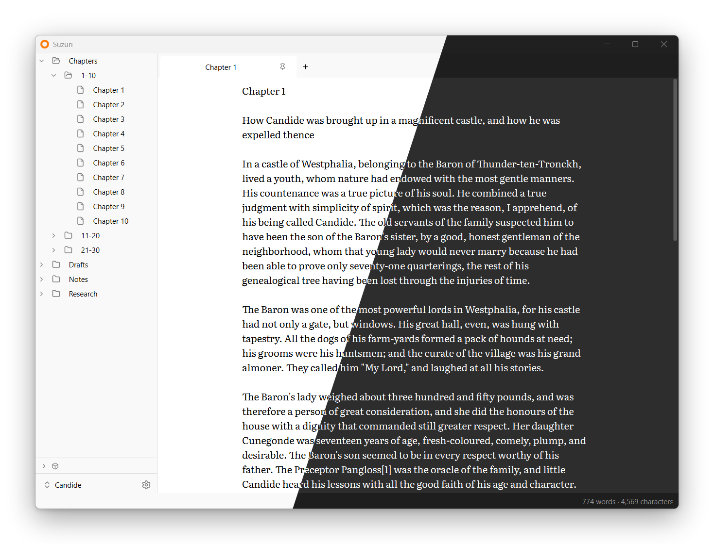

<h1 align="center">
    
    <br>
    Fernanda
</h1>
<p align="center">
    <b>A plain-text writing app for fiction, poetry, and long projects</b>
    <br>
    Obsidian-style vaults. Your files stay plain text, on disk.
</p>
<p align="center">
    <a href="LICENSE"></a>
    <a href="https://qt.io/"></a>
    <a href="https://github.com/fairybow/Fernanda/actions/workflows/ci.yml"></a>
    <br>
    <a href="https://github.com/fairybow/Fernanda/releases"></a>
    <a href="https://github.com/fairybow/Fernanda/releases"></a>
    <br>
    <a href="https://github.com/fairybow/Fernanda/releases"><b>Download</b></a> •
    <a href="#coming-from-obsidian"><b>Coming from Obsidian?</b></a> •
    <a href="Fernanda/docs/Features.md"><b>Features</b></a> •
    <a href="Fernanda/docs"><b>Documentation</b></a>
</p>
<p align="center">
    &nbsp
    <br>
    
    <br>
    &nbsp
</p>

## About

I'm a writer, and Fernanda is a personal project: the writing app I've wanted for myself.

Its design is based on [Obsidian](https://obsidian.md/), where a vault is just a folder on your computer. But Fernanda is meant for writing projects (novels, poetry, collections), and everything you write stays in plain-text files you own and can open in any editor.

Fernanda is early in development, and more features are planned. I expect to keep working on it for a long time.

> [!WARNING]
> Fernanda hasn't reached 1.0 yet. Keep regular backups of your work.

*Fernanda is an independent project and isn't affiliated with or endorsed by Obsidian.*

## Features

- **A vault is a folder.** Open any folder as a vault. Fernanda adds one hidden folder for its settings and leaves the rest alone
- **No Save command.** Every file exists on disk from the moment it's created, and changes are written as you type
- **Your text is written back as it was read.** Line endings, byte order marks, no-break spaces, and other special characters are preserved
- **Tabs, split panes, and pop-out windows.** The same file can be open in any number of them, in sync, with one undo history
- **A Common Vault** shared by every project, for templates, notes, and reference material
- **A file tree and Go to File** (Ctrl+O), with drag-and-drop moves and delete-to-trash
- **Find and replace** in a file, with match case and whole word
- **Spellcheck** as you write, with suggestions and a dictionary of your own words for each vault. US English is bundled, and other Hunspell dictionaries can be added
- **Changes made elsewhere are picked up.** A file edited in another program, by Git, or by a sync client reloads in place, as one undo step
- **PDFs and images** open read-only beside your text
- **Typing helpers** that pair brackets and quotes, and let you step past a closing one with a second space
- **A word counter**, bundled fonts for prose, and settings kept per vault
- **English and Spanish,** with Spanish still a draft

Fernanda edits plain text. Markdown and Fountain files open as the text they are, with no rendering for now. There are no links, tags, or metadata.

The full list is in [Features.md](Fernanda/docs/Features.md), and what's planned is in [Future.md](Fernanda/docs/Future.md).

## Coming from Obsidian?

Fernanda works the way Obsidian does wherever it can, so vaults, tabs, splits, Go to File, and the settings will feel familiar. Where it differs, it's mostly because it's built for long-form prose in plain text:

- **`.txt` is a first-class file type,** and the default for new files. Obsidian doesn't open `.txt` at all
- **A Common Vault shared by every project,** for templates, notes, and research you want in reach whatever you're working on. Every window shows it in a drawer under its own files, and a Common Vault file open in two windows stays in sync as you type. Obsidian vaults can't share files, short of the symlinks its help advises against
- **Your files come back exactly as they went in.** Line endings are kept as they were (Obsidian rewrites them to LF), along with byte order marks, no-break spaces, and other special characters
- **A save that fails stops the window from closing,** so nothing is lost silently. Obsidian shows a notice and closes
- **Bold and italic for the text font,** since there's no Markdown styling to carry emphasis, and **a margin setting** in place of "Readable line length," with a switch to turn wrapping off
- **Find has Match case and Whole word,** and its highlights stay while you edit
- **Go to File lists every file** with nothing typed, the recent ones first
- **Stepping past closing punctuation:** a second space before a closing bracket or quote moves past it, and the comma or period after goes before the space
- **Images zoom** like PDFs, and TIFF images open
- **Free and open source** under the GPL, and a native desktop app built with Qt, not Electron

There's more, and the full list is in [Features.md](Fernanda/docs/Features.md#differences-from-obsidian).

## Installing

Download the latest build for Windows, macOS, or Linux from [Releases](https://github.com/fairybow/Fernanda/releases). Each release's notes cover installing, updating, and uninstalling. Fernanda tells you when a newer version is out (you can turn that off in Settings → General), and links you to it.

The builds are unsigned, so Windows and macOS will warn you the first time you run one. The macOS and Linux builds aren't well tested yet.

## Building

You'll need:

- CMake 3.21 or later
- A C++20 compiler: MSVC 2022, GCC 13, or Apple Clang
- Qt 6.7 or later, with the Qt PDF and Qt Image Formats modules. Fernanda is developed on Qt 6.11

Clone with submodules, since [Coco](https://github.com/fairybow/Coco) (Fernanda's support library) and [Hunspell](https://github.com/hunspell/hunspell) are submodules:

```
git clone --recurse-submodules https://github.com/fairybow/Fernanda
cd Fernanda
```

Then configure, build, and run the tests. Point `CMAKE_PREFIX_PATH` at your Qt kit:

```
cmake -B build -S Fernanda -DCMAKE_BUILD_TYPE=Release -DCMAKE_PREFIX_PATH=/path/to/Qt/6.11.2/gcc_64
cmake --build build --parallel
ctest --test-dir build --output-on-failure
```

On Windows, with Visual Studio's generator, the configuration is chosen at build time:

```
cmake -B build -S Fernanda -DCMAKE_PREFIX_PATH=C:/Qt/6.11.2/msvc2022_64
cmake --build build --config Release --parallel
ctest --test-dir build -C Release --output-on-failure
```

On Linux you'll also need the usual Qt build dependencies. On Ubuntu:

```
sudo apt-get install libxcb1-dev libx11-xcb-dev libxkbcommon-dev libgl1-mesa-dev
```

Pass `-DAPP_BUILD_TESTS=OFF` to skip building the tests.

## Support

I enjoy working on Fernanda, and I'm genuinely grateful for any support. You can do that [here](https://ko-fi.com/fairybow).

But if you're going to give anywhere, I'd rather you please give to [United24 🇺🇦](https://u24.gov.ua/) and help defend Ukraine. Civilians there are under attack every day, and your money will do far more good that way.
